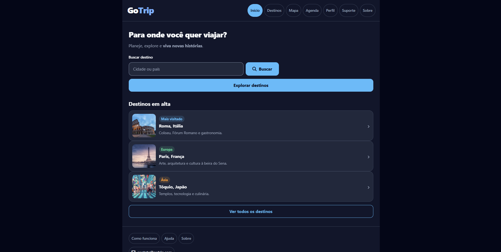

<!-- ===== README.md — na raiz do repositório, com esse nome exato ===== -->

# GoTrip

Aplicativo desenvolvido para ajudar as pessoas a organizar suas viagens de maneira simples e prática, reunindo informações importantes em um só lugar.

## O problema

Organizar uma viagem pode ser complicado, principalmente quando é necessário pesquisar destinos e reunir informações em diferentes lugares. O GoTrip foi desenvolvido para facilitar esse processo, ajudando os usuários a planejar e organizar suas viagens em um só aplicativo.

## Telas

| Tela | O que faz |
|---|---|
| Home | Apresenta o aplicativo e suas principais opções. |
| Cadastro | Permite que novos usuários criem uma conta. |
| Login | Permite que os usuários acessem suas contas. |
| Destinos | Apresenta opções de destinos para conhecer e visitar. |
| Perfil | Exibe as informações do usuário. |

## Tecnologias

- HTML5
- CSS3

## Como rodar

1. Clone o repositório:
   `git clone https://github.com/salomeram/GoTrip.git`
2. Entre na pasta do projeto: `cd GoTrip`
3. Abra o `index.html` no navegador, ou use a extensão Live Server do VS Code.

Não precisa instalar nada, pois o projeto utiliza apenas HTML e CSS.

## Quem fez o quê

| Integrante | Parte |
|---|---|
| Isabella | Desenvolvimento das telas e organização do projeto. |
| Salomé | Desenvolvimento das telas e organização do projeto. |

## Status

- [x] Estrutura das telas do projeto
- [x] Home
- [x] Cadastro
- [x] Login
- [x] Destinos
- [x] Perfil
- [ ] Revisar e testar todas as funcionalidades
